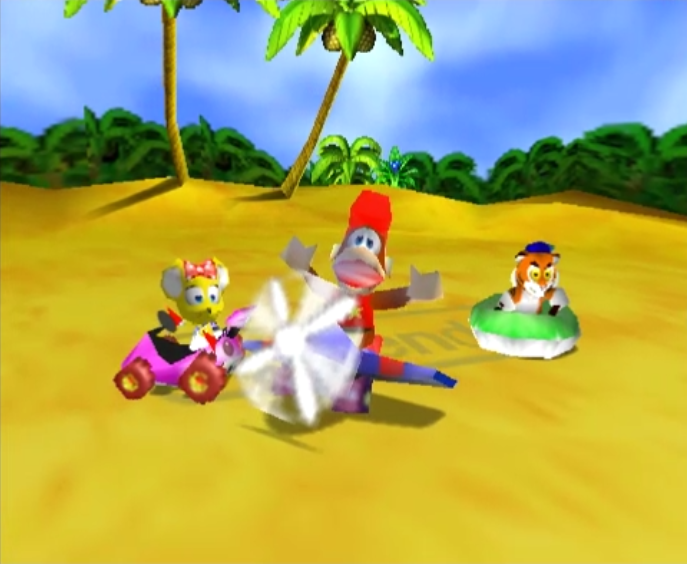
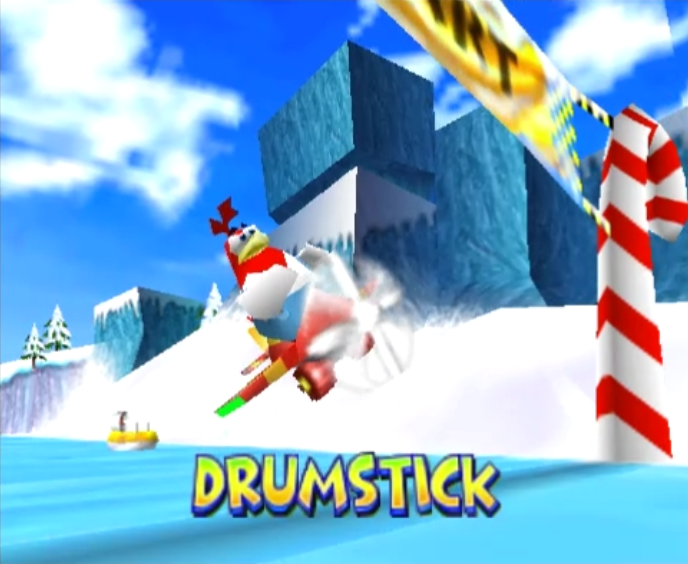

# Diddy Kong Racing on Nintendo Wii

**An unofficial homebrew port of [DKR-R](https://github.com/ThatGuyMcd/DKR-R) (Diddy Kong Racing Recompiled) to the Nintendo Wii.**
The game's own code runs natively on the console's PowerPC processor — no emulator.

> **Status: alpha (v0.1.0-alpha).** Playable on real Wii hardware and Dolphin. Distributed under the **MIT License**. Contributions and feedback are welcome — see [Known issues](#known-issues) for priority areas.

  
  

## About the game
*Diddy Kong Racing* is a racing game developed by Rare for the Nintendo 64 and released in November 1997 (21 Nov in Japan and Europe, 24 Nov in North America).
Instead of a plain grand prix, it mixes karts, hovercraft and planes with an **adventure mode**: you explore a hub island, meet characters such as Diddy Kong, Timber, Conker or Banjo, collect balloons to unlock new worlds, and finally face the wizard-pig Wizpig.
It sold about 4.5 million copies and was recognised as the fastest-selling game of its time. Rare later made a remake for the Nintendo DS (2007); two planned sequels were cancelled after Microsoft bought Rare in 2002
([Wikipedia](https://en.wikipedia.org/wiki/Diddy_Kong_Racing)).

## Why a Wii port?
The game has **never been released on the Wii**. The N64 original needs N64 hardware or an emulator, and the DS remake is a different game.
This project brings the original game to the Wii as a native homebrew application: you bring your own copy of the game, and the Wii runs it directly.

## What the Wii version offers
- **Native speed**: the N64 code is converted ahead of time to PowerPC (static recompilation), so the game runs at its original 30 FPS in most scenes, with no emulation overhead.
- **Sharper picture**: the 3D scene is drawn at the Wii's 640×480 (the N64 version typically uses a 320×240 frame buffer), with bilinear texture filtering and a fix for dark outlines around sprites.
- **480p support**: progressive-scan output with a component cable, or 480i with the standard cable; correct 4:3 on 16:9 TVs (black bars on the sides).
- **Wii-style controls**: GameCube controller, Wii Remote + Nunchuk, Classic Controller, **tilt steering** (Wii Remote held sideways), rumble.
- **Launcher with settings**: language (English, French, Spanish, German, Italian, Portuguese, Japanese, Korean), aspect ratio, video mode, tilt, dead zone, texture filter, image smoothing, audio.
  It also checks that your ROM is a supported version and shows "ROM OK".
- **Native audio**: the game's sound engine is replaced by a mixer written for the Wii's CPU (about 4× cheaper than emulating the original microcode).
- **Hardware features**: hardware fog, two-texture animated water, transparent smoke/particles/tyre marks, saves on the SD card, optional on-screen FPS overlay.
- **Local multiplayer** for 1 to 4 players, exactly like the N64 game.

## What was changed compared with the original DKR-R
DKR-R is a Windows/Linux PC project. The Wii port keeps its recompiled game code and rewrites everything that touches the hardware.

| Area | Original DKR-R (PC) | This Wii port |
|---|---|---|
| Platform | x86-64 PC, little-endian | Wii PowerPC 750CL, **big-endian**, libogc / devkitPPC |
| Graphics | RT64 renderer (Vulkan / Direct3D) | **New renderer for the GX GPU**: converts the game's display lists to GX, emulates the N64 texture memory, maps the N64 color combiner to GX stages |
| Audio | The original RSP sound microcode, recompiled to native code | **Native PowerPC mixer** replacing the microcode |
| Threads and timing | Host threads on a PC | Adapted scheduler, thread-local storage and atomics for libogc; N64 runtime patched (`runtime-patches/`) |
| Input | SDL3: keyboard, gamepads, gyro | GameCube pad, Wii Remote + Nunchuk, Classic Controller, tilt steering, rumble |
| Interface | PC launcher and in-game settings overlay | **Software launcher** drawn on the video buffer: 8 languages, ROM SHA-1 check, Wii-specific options |
| Video output | Windowed or full-screen at any resolution | 480i / 480p, 4:3 with bars on widescreen TVs |
| Saves | Save files in the user folder | Files on the SD card (`sd:/apps/DKR-R/dkr-runtime-data/`) |
| Online multiplayer | Included | **Removed** (replaced by a local-only stub) |
| PC-only extras | Widescreen, interpolated high frame rate, texture packs, overlays | Not included: the Wii port keeps the original 4:3 / 30 FPS presentation |
| Build | CMake for Windows / Linux | Cross-compiled with devkitPPC in a Docker image |

## Installation
1. Extract the release archive at the **root of your SD card** (FAT32). You get `sd:/apps/DKR-R/`.
2. Copy **your own legally obtained US ROM** of Diddy Kong Racing (v1.0 or v1.1 / Rev A, big-endian `.z64`) to `sd:/apps/DKR-R/dkr.z64`. No ROM or game asset is included.
3. Start *Diddy Kong Racing Recompiled* from the Homebrew Channel. Saves go to `sd:/apps/DKR-R/dkr-runtime-data/`.

Only the two known US versions are accepted for now.

## Under the hood
The interesting problems, in plain words (the code is in `runtime-recomp/src/game/`):

- **Running the N64's code on the Wii.** The N64 and the Wii's CPU are both big-endian, so the game's recompiled code runs without any byte swapping. The N64 runtime it relies on (scheduler, threads, audio hooks) needed patches for the Wii's C library (`runtime-patches/`).
- **Drawing N64 triangles with the Wii GPU.** The N64 sends vertices that are already projected on screen, so the Wii GPU cannot correct textures for perspective by itself. We cut large triangles into smaller ones, edge by edge so that neighbours stay consistent, until textures look right.
- **Reproducing the N64 colour and blending modes.** The N64's color combiner (how a texture, shading and fog are mixed) is translated into the Wii's texture stages, with special cases for water (two textures), tyre marks, smoke and fog.
- **Depth.** A bug where the background was drawn over a piece of scenery came down to one flag: the N64 decides whether a surface writes its depth separately from whether it is blended, and the port had tied them together.
- **HUD alignment.** The balloon counter drifted away from its text because HUD sprites are positioned on a different scale than text; a 4/3 vertical correction fixed it.
- **Native audio.** Instead of emulating the sound chip's program, the port reimplements what it does (decoding, resampling, mixing, reverb) directly for the Wii's CPU. In our measurements this cut the audio cost by about 4× and brought the frame rate up to 30 FPS.
- **Developer tools** (disabled unless the launcher's debug panel is on): a network debug channel to change settings live, depth and colour captures, and a mode that draws the same frame with several settings to find rendering bugs.

## Known issues
- Dark fringes around some text and images, stray polygons and texture glitches on real hardware (not reproduced under the Dolphin emulator).
- Water's second texture and the fog have only been verified under Dolphin; the experimental "enhanced" filtering is disabled.
- Sky domes and near-road geometry can shimmer; the frame rate dips to about 20–27 FPS in heavy scenes.
- US ROMs only; no online multiplayer.

## What is in this repository
This repository contains only the code that is **new or modified compared with DKR-R**. It is **not meant to build as is**: the rest of the DKR-R tree, the recompiled game code (generated from your ROM) and the patched N64 runtime are needed.
No ROM, no game asset and no binary are in the repository (the release archive contains the compiled `boot.dol`).

| Path | Content |
|---|---|
| `runtime-recomp/src/game/null_renderer.cpp` and `wii_renderer_*.inc` | The GX renderer, split by role (state, configuration, RDP state, geometry, display-list parser with one function per opcode, debug, profiling) |
| `runtime-recomp/src/game/wii_textures.inc` | N64 texture memory emulation, texture decoding, texture cache in MEM2, colour combiner to GX stages |
| `runtime-recomp/src/game/native_audio_mixer.*` | Native PowerPC audio mixer |
| `runtime-recomp/src/game/wii_launcher.cpp` | Software launcher (and `wii_launcher_font.inc`) |
| `runtime-recomp/src/game/wii_*.cpp` | libogc shims, local-only netplay stub, debug channel, optional profiler |
| `runtime-recomp/src/game/game_main.cpp`, `runtime_platform.cpp`, … | DKR-R files modified for the Wii: boot, ROM search, input, threads |
| `UPSTREAM-DIFF.patch` | The exact changes made to DKR-R's own files |
| `runtime-patches/` | Changes to N64ModernRuntime and N64Recomp needed on the Wii |
| `cmake/`, `docker/`, `runtime-recomp/CMakeLists.txt` | devkitPPC toolchain and build integration |

## Credits and licence
Wii port: see [`CREDITS.md`](CREDITS.md). DKR-R is by ThatGuyMcd and contributors. Built on [N64Recomp](https://github.com/N64Recomp) and N64ModernRuntime, with [libogc / devkitPro](https://devkitpro.org);
the [Diddy Kong Racing decompilation](https://github.com/DavidSM64/Diddy-Kong-Racing) was used as a reference for the game's behaviour.
Everything here is released under the **MIT License** ([`LICENSE`](LICENSE)); third-party notices are in [`THIRD_PARTY.md`](THIRD_PARTY.md).
*Diddy Kong Racing* is a trademark of Nintendo / Rare; this project is not affiliated with them.
